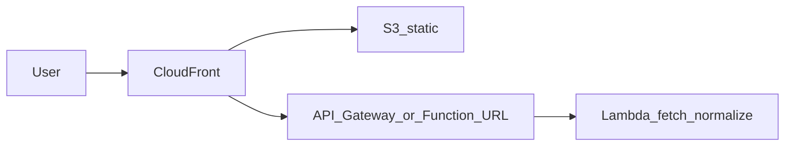

# Chess games history: two-phase plan

## Current constraints in the repo

- [`src/middleware.ts`](src/middleware.ts) forces login on almost every route; [`src/auth/`](src/auth/) + [`src/app/api/auth/[...nextauth]/route.ts`](src/app/api/auth/[...nextauth]/route.ts) exist only for that. **Removing auth** means deleting or bypassing this middleware and simplifying [`Header.server.tsx`](src/app/_components/composed/Header/Header.server.tsx) / [`Header.client.tsx`](src/app/_components/composed/Header/Header.client.tsx) (no session, no logout).
- [`src/app/core/fenInterpreter.ts`](src/app/core/fenInterpreter.ts) is a stub; boards need **real FEN** (from PGN or API fields).
- No non-auth API routes yet—good place for a **Lambda-backed** fetch layer in production.

---

## Frontend framework: keep Next.js?

**Recommendation: yes, keep Next.js** for this project.

- The repo is already **Next.js 15 (App Router) + Tailwind**; the planned UI is **mostly client-side** (virtualized lists, analytics in JS) with **optional static export** to S3. That maps cleanly to Next without needing SSR for core features.
- **Route handlers** in development mirror Lambda behavior (`/api/...`), so you avoid maintaining two HTTP frameworks during Phase 1.
- **Alternatives** are viable but trade away familiarity: **Vite + React** is slightly simpler for “pure SPA + separate API” but means migrating layouts, routing, and tooling; **Remix** shines when server rendering and forms matter more—here they do not. **SvelteKit / Nuxt** are fine but rewrite the stack.

**When Next would be the wrong pick:** if you later require heavy SSR, edge middleware, or complex server components across every page—still possible in Next, but your cost model (S3 static + Lambda API) intentionally stays **thin on the server**. For that shape, Next is **a strong fit**, not merely acceptable.

---

## Dev and production environments (AWS)

**Constraint (locked):** use **one AWS account** for everything. Run **dev** and **prod** as **two isolated stacks** in that account so a bad dev deploy cannot touch prod.

- **Naming:** Prefix all resources by environment, e.g. `chess-stats-dev-*` vs `chess-stats-prod-*` (S3 buckets, Lambda functions, IAM roles where scoped per env). Often **two CloudFront distributions** (one URL for dev, one for prod) is simpler than one distribution with multiple origins; either is fine if behaviors are clearly separated.
- **APIs:** **Separate** API Gateway (or Function URL) + **separate** Lambda per env; different `NEXT_PUBLIC_API_BASE_URL` in the static build per pipeline.

**Local development:** `next dev` with Route Handlers calling real APIs (or mocks); **no AWS required** day to day. **Deployed dev** is optional but useful for sharing builds—point `NEXT_PUBLIC_API_BASE_URL` at the **dev** Lambda/API URL.

**Configuration:** One codebase; environment via **build-time** and **runtime** env vars (e.g. API base URL, optional feature flags). **Secrets** (Bedrock keys in Phase 2) live in **SSM Parameter Store** or Lambda env—never in the static S3 bundle (use **different** SSM paths or Lambda env per env, e.g. `/chess-stats/dev/...` vs `/chess-stats/prod/...`).

**CI/CD (lightweight):** e.g. GitHub Actions: on `main` → build static → sync **prod** S3 + update **prod** Lambda; on `develop` or manual workflow → **dev** stack. One **IAM deploy role** in the same account; branch or workflow selects the **parameter set** (bucket names, Lambda ARNs, prefixes).

**Networking (explicit — no NAT Gateway):** API Lambdas that call **public HTTPS** endpoints (Chess.com, Lichess, Bedrock) must use **Lambda with no VPC attachment** (default), so outbound traffic uses AWS-managed internet access **without** a **NAT Gateway**. Do **not** place these functions in **private subnets** that would “require” NAT for outbound internet—that pattern is **out of scope** and would blow the budget (~**$32+/month** per NAT Gateway alone, plus data processing). If you ever need a VPC for another reason, use alternatives that avoid NAT (e.g. **VPC endpoints** only for supported AWS APIs, or redesign)—**NAT Gateway is not part of this project’s architecture.**

---

## AWS billing: **$20/month maximum** (constraint)

**Goal:** keep **total AWS charges** for this app (dev + prod resources in the one account, for this project) **at or below ~USD $20/month** under normal personal / light-traffic use.

**Important:** Dollar figures below are **rough order-of-magnitude** (vary by region, traffic, and free-tier eligibility). Use the [AWS Pricing Calculator](https://calculator.aws/) for your region and turn on **AWS Budgets** with **email alerts** (e.g. **~$16** warning, **~$20** threshold) alongside the guardrails below.

**Guardrails (keep):** Budgets/alerts, low Lambda memory, optional caching, Bedrock **token and rate limits**—see Phase 2. **Excluded by design:** **NAT Gateway** (see **Networking** under Dev environments)—not only unnecessary for this stack but costly and contrary to the budget.

### Phase 1 (S3 + CloudFront + Lambda API)

| Typical charge | Why it stays small |
|----------------|-------------------|
| **S3** (static site) | Few MB of HTML/JS/CSS; storage + PUTs often **&lt; $0.50/mo**. |
| **CloudFront** | Low egress (personal traffic): often **~$0–4/mo** depending on GB served; first-time accounts may have **Free Tier** benefits for 12 months—confirm current terms. |
| **Lambda** (fetch/proxy) | Short runs, modest invocations: often **within free tier** or **&lt; $2/mo**; keep memory low (128–256 MB) and timeout reasonable. |
| **API Gateway HTTP API** (if used) | ~$1 per million requests—optional; **Lambda Function URL** avoids API Gateway request charges (you still pay Lambda). |
| **Other** | Route 53 hosted zone ~$0.50/mo if you use a custom domain; optional ACM certs are free for public use. |

**Phase 1 realistic band:** for a **low-traffic** hobby app, **~$1–6/month** is common; **$20** is a comfortable ceiling if traffic stays personal/small and you avoid expensive mistakes (especially **NAT**—see networking note).

**Ways to stay under $20 in Phase 1**

- Prefer **Lambda Function URL** or **HTTP API** only if you need features—avoid unnecessary API Gateway tiers.
- **Two environments** in one account doubles some fixed pieces (e.g. two CloudFront distributions): keep **dev** minimal or tear down when idle.
- **Cache** Chess.com/Lichess proxy responses briefly (CloudFront or in-Lambda) to cut repeat Lambda + origin work.

### Phase 2 (analytics + optional AI)

| Workload | AWS cost impact |
|----------|-----------------|
| **Analytics in the browser** (default) | **$0** extra—no new AWS services required. |
| **Heavier aggregation in Lambda** | Small **Lambda** bill increase if you batch; still usually **well under $20** combined with Phase 1 if invocations stay low. |
| **Amazon Bedrock** (coaching) | **Highest risk** to the budget: priced **per token**; uncontrolled use can exceed **$20/mo fast** without throttling. |

**Staying under $20 with Phase 2 included**

- Treat **Bedrock as optional**; ship analytics **without** AI first.
- If you enable Bedrock: **smallest/cheapest** model sufficient for short coaching blurbs; **strict** `max_tokens`, **per-IP or per-session rate limits**, and **no** “send entire PGN history” prompts.
- Set **AWS Budgets** at **~$20** with alerts (e.g. warning at **~$16**); consider **monthly spend cap** patterns (application-level: disable AI route when quota exceeded).
- Alternative to Bedrock for extreme cost control: run coaching **client-side** with a user-supplied API key (not AWS billing)—only if you accept that product tradeoff.

**Phase 2 realistic band:** analytics-only Phase 2 often keeps you in the **same ~$1–6/mo** range as Phase 1; **with Bedrock**, treat **$20** as a **hard cap** requiring **monitoring and throttling**, not a default expected spend.

---

## Data sources (what each API gives you)

| Need | Chess.com PubAPI | Lichess API |
|------|-------------------|-------------|
| List games / bulk data | Player **archives** then **monthly** PGN URLs ([published-data doc](https://www.chess.com/news/view/published-data-api)) | `GET /api/games/user/{username}` (NDJSON or PGN) |
| Timestamps for sessions | PGN headers (`UTCDate` / `UTCTime`) + end of game in PGN | JSON fields (`createdAt`, `lastMoveAt`, clocks) — **strong for ordering** |
| Ratings for ELO analytics | Often in PGN headers (`WhiteElo`, `BlackElo`) | In JSON and PGN |
| Final position | Parse PGN to last position | Same, or derive from game JSON |

**Normalization:** Define one internal type, e.g. `UnifiedGame`: `{ source: 'chesscom' \| 'lichess', id, playedAt: Date, endAt: Date, whiteName, blackName, userColor, result, pgn?, initialFen?, whiteRating?, blackRating?, opening?: { eco?, name? } }`. Fill it in **one ingestion module** per provider so UI and analytics never branch on raw API shapes.

**CORS / keys:** Chess.com PubAPI is often consumed from a **server** (your **Lambda**) to set a stable `User-Agent` with contact info and avoid browser CORS issues. Lichess is more browser-friendly but proxying everything through Lambda keeps one pattern and hides implementation details.

---

## Phase 1: Basic app (APIs + boards + styling + AWS baseline)

### 1.1 Product shell (no auth)

- Remove NextAuth usage: middleware, auth route, `SessionProvider`, sign-out, [`package.json`](package.json) dependency when unused.
- Home: form for **optional** Chess.com username + **optional** Lichess username + “Load games” (your [`DynamicForm`](src/app/_components/composed/DynamicForm/DynamicForm.tsx) can hold this).
- Games route: accept query params or client state (e.g. Zustand/context) listing merged games; show loading / empty / error states.

### 1.2 Fetch layer

- **Dev:** Next.js Route Handlers under `src/app/api/...` that proxy to Chess.com and Lichess (mirrors Lambda behavior).
- **Prod:** Same logic packaged as **one Lambda** (Node 20) behind **API Gateway HTTP API** or **Lambda Function URL** (cheapest for low traffic). **CloudFront** can route `/api/*` to API Gateway and `/*` to S3 origin (single domain, HTTPS).

Implementation notes:

- **Chess.com:** `GET /pub/player/{username}/games/archives` → list of monthly archive URLs → fetch each PGN → parse.
- **Lichess:** Paginate `max`/`since` per [Lichess API](https://lichess.org/api) until no more games (respect fair use; serial or low concurrency).
- **Rate limits:** Serial requests or small pools; backoff on `429` (Chess.com documents parallel limits).

### 1.3 PGN / FEN pipeline

- Add **`chess.js`** (or `chessops` + small glue): load PGN, play to end, **`.fen()`** for final position. Use that string for [`ChessBoard`](src/app/_components/composed/ChessBoard/ChessBoard.client.tsx).
- Complete [`fenInterpreter.ts`](src/app/core/fenInterpreter.ts) (or replace with chess.js output) so **only valid FEN** renders pieces.

### 1.4 UI: boards + virtual scrolling

- Use **`@tanstack/react-virtual`** or **`react-window`**: one scroll container, each row = metadata + small board (fixed height for stable virtualization).
- Optional: lazy-mount heavy rows (intersection observer) if boards are still expensive on low-end devices.

### 1.5 Styling

- Keep Tailwind; align typography/spacing with a simple design system (card per game, clear platform badge). Polish header/footer after auth removal.

### 1.6 AWS: simple, cheap deployment

- **S3:** Host **static** Next export (`output: 'export'` in [`next.config.ts`](next.config.ts)) **or** use a community adapter (e.g. OpenNext) if you must keep SSR—**static export + client-side routing** is usually cheapest for this use case.
- **CloudFront:** HTTPS, caching for static assets; optional short TTL cache on `/api/*` if responses are cacheable by query string (username params).
- **Lambda:** Implements the same handlers as local `/api` routes; return JSON list of `UnifiedGame` (truncate PGN in list if payload is huge; full PGN only when needed for Phase 2).
- **Dev vs prod:** Duplicate the diagram per environment **inside the same account** (separate prefixed S3 buckets + Lambdas + optionally separate CloudFront URLs or `dev.` / `app.` DNS). Same Terraform/CDK/CloudFormation templates with different **parameters**; see **Dev and production environments** above.

**Cost control:** No RDS/DynamoDB in Phase 1 unless you need cross-session caching. See **AWS billing: $20/month maximum** for per-service estimates and the **$20** ceiling. Add **S3 object caching** of normalized JSON per `{user,site}` only if API usage or latency becomes an issue.

**Lambda networking:** Deploy fetch/proxy Lambdas **without a VPC** (or any pattern that would imply a **NAT Gateway**). Public HTTPS to Chess.com/Lichess/Bedrock does not require NAT; see **Networking (explicit — no NAT Gateway)** above.

---

## Phase 2: Analytics and AI

### 2.1 Session analytics (your “longest session” questions)

- After merge, **sort** by `endAt` (or `playedAt` if end missing).
- Define **session boundary**: e.g. gap between consecutive game ends **> 30–60 minutes** = new session (tuneable).
- **Longest session:** max count or max duration of consecutive games in a cluster.
- **ELO vs session length:** Pair each game’s **rating change** (need rating before/after—use ordered games and header ratings, or Lichess `players` JSON) with **session id**; aggregate with simple regression or buckets (e.g. “games per session” vs “delta rating”).

Chess.com/Lichess both expose enough **timestamps and ratings** in exports for MVP; edge cases (missing rating) should be filtered or labeled “unknown.”

### 2.2 Opening analytics

- From PGN: first N plies (e.g. 8–10) or **ECO** if present; normalize to a string key (SAN sequence).
- **Favourite openings:** frequency of keys where user was White (and separately Black if you want).
- **Win rate by opening:** wins / (wins + losses + draws) per key.
- **Enemy opening:** same keys from **opponent’s** perspective when user is Black (or invert when White); win rate against those keys.

Run **in the browser** for moderate game counts; if **> ~5–10k games** gets slow, move aggregation to **Lambda** (same data, batch job or on-demand compute) and return summary JSON.

### 2.3 AI coaching (optional; budget-sensitive)

- **Lambda** invokes **Amazon Bedrock** (or a small external API) with **structured prompts**: user stats summary + a few PGN snippets—**never** send full multi-year history in one prompt.
- Guardrails: rate limit per IP, **low `max_tokens`**, optional “coach my last 5 losses” UX—required to keep **Phase 1 + Phase 2 total AWS** near the **$20/mo** cap (see **AWS billing**).

### 2.4 Phase 2 AWS additions (still minimal)

- Same Lambda can gain **Bedrock** IAM permission; no new always-on servers.
- Optional: **DynamoDB** or **S3 JSON** store for “last computed analytics” if you add user accounts later—**skip until needed**.

---

## Suggested order of work (Phase 1 checklist)

1. Remove auth; public routes and simplified header/footer.  
2. `UnifiedGame` type + Chess.com + Lichess ingest (dev API routes first).  
3. PGN → FEN with chess.js; fix board rendering.  
4. Search UI + games page with virtualized list.  
5. Styling pass.  
6. Wire **static export** + **Lambda** + **CloudFront/S3** and point frontend `fetch` to `/api` on same domain.

---

## Risks / decisions to accept upfront

- **Very large** game volumes: paginate UI, stream NDJSON on Lichess, chunk Chess.com months; consider hard caps in UI with “load older.”  
- **Session definition** is heuristic without device-level “app session” data—document the rule in the UI.  
- **AI** is optional and should be **Phase 2** only after aggregates are trustworthy.  
- **$20/mo AWS cap:** requires **Budgets + alerts**; **Bedrock** is the main service that can break the cap without throttling—plan analytics **without** AI first if budget is strict. **NAT Gateway** is **not** in architecture—avoid VPC patterns that imply it.
